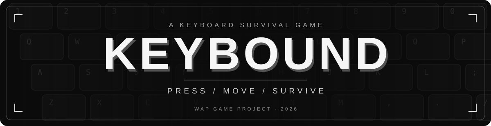
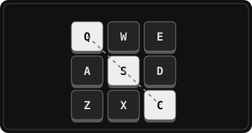
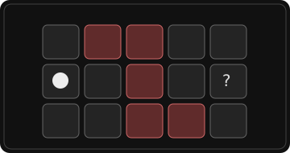
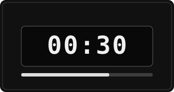
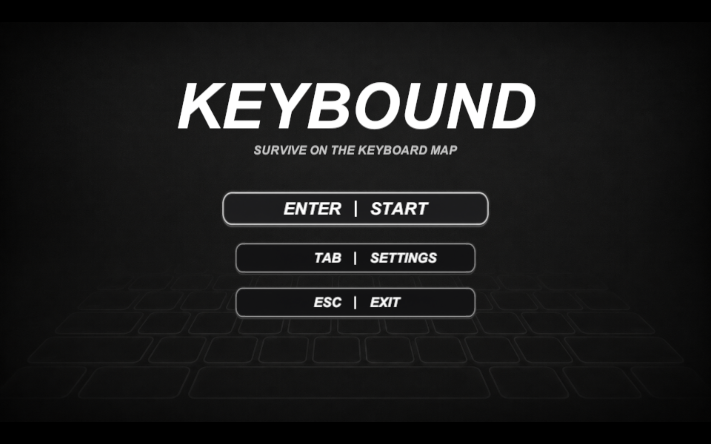
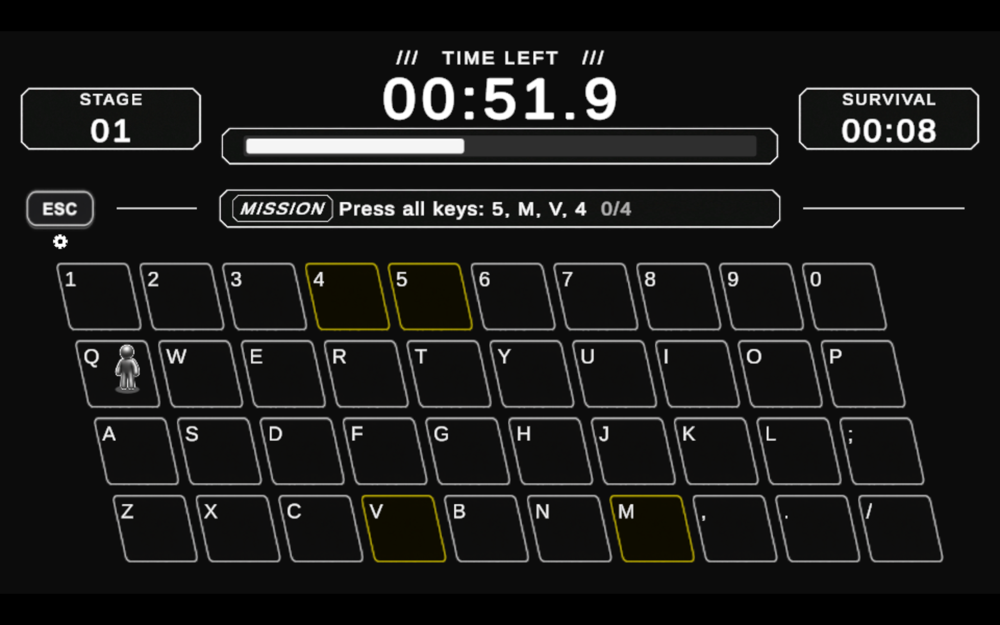
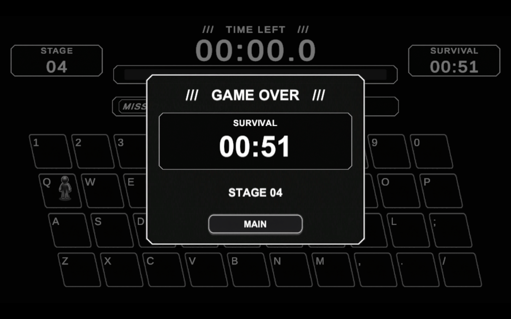

<!-- Replace OWNER/REPOSITORY and the team names before publishing. -->

  

  <picture>
    <source media="(prefers-color-scheme: dark)" srcset="https://readme-typing-svg.demolab.com/?font=JetBrains+Mono&amp;weight=700&amp;size=24&amp;duration=2500&amp;pause=1000&amp;center=true&amp;vCenter=true&amp;width=700&amp;height=55&amp;lines=YOUR+KEYBOARD.+YOUR+WORLD.;PRESS.+MOVE.+SURVIVE.;EVERY+SECOND+MATTERS.;HOW+LONG+CAN+YOU+SURVIVE%3F&amp;color=EEEEEE" />
    <source media="(prefers-color-scheme: light)" srcset="https://readme-typing-svg.demolab.com/?font=JetBrains+Mono&amp;weight=700&amp;size=24&amp;duration=2500&amp;pause=1000&amp;center=true&amp;vCenter=true&amp;width=700&amp;height=55&amp;lines=YOUR+KEYBOARD.+YOUR+WORLD.;PRESS.+MOVE.+SURVIVE.;EVERY+SECOND+MATTERS.;HOW+LONG+CAN+YOU+SURVIVE%3F&amp;color=292929" />
    
  </picture>

<h3 align="center">손끝에서 시작되는 또 다른 세상, 키보드로 플레이하다!</h3>

  키보드 자체가 게임의 무대가 되는 생존 액션 게임. 
  키보드를 터치패드처럼 쓸어가며 움직이고, 다양한 미션에 도전하세요.

   
  GitHub Releases · 최신 빌드

---

<h2 align="center">PRESS. MOVE. SURVIVE.</h2>

<table>
  <tr>
    <td width="33%" align="center"></td>
    <td width="33%" align="center"></td>
    <td width="33%" align="center"></td>
  </tr>
  <tr>
    <td align="center"><strong>01 / MOVE</strong></td>
    <td align="center"><strong>02 / CHALLENGE</strong></td>
    <td align="center"><strong>03 / SURVIVE</strong></td>
  </tr>
  <tr>
    <td align="center">손가락이 움직이는 곳으로 캐릭터도 움직입니다.</td>
    <td align="center">다양한 미션과 미니게임, 보스 스테이지에 도전하세요.</td>
    <td align="center">시간이 곧 생명입니다. 자신의 기록을 뛰어넘으세요.</td>
  </tr>
</table>

### How to Play

- 현재 위치를 중심으로 주변 3×3 범위의 인접 키를 눌러 이동하세요.
- 미션 성공 시 시간이 추가되고, 실패하거나 장애물에 충돌하면 시간이 감소합니다.
- 미션에 실패해도 다음 미션에 도전할 수 있습니다. 남은 시간이 0이 되면 게임이 종료됩니다.

<strong>당신은 얼마나 오래 살아남을 수 있을까요?</strong>

---

<h2 align="center">SCREENSHOTS</h2>

<table>
  <tr>
    <td width="50%" align="center"> START SCREEN</td>
    <td width="50%" align="center"> GAMEPLAY</td>
  </tr>
</table>

   
  GAME OVER

---

<h2 align="center">BUILT WITH</h2>

  
  
  

<h2 align="center">TEAM</h2>
<table align="center" width="100%">
  <tr>
    <td width="33.33%" align="center">
    <a href="https://github.com/O-Chunk">
    
     
    <strong>김찬영</strong></a> TEAM LEADER / DEVELOPER</td>
    <td width="33.33%" align="center">
    <a href="https://github.com/sasanga7777">
    
     
    <strong>박치헌</strong></a> DEVELOPER</td>
    <td width="33.33%" align="center">
    <a href="https://github.com/psvm203">
    
     
    <strong>이문빈</strong></a> MANAGER</td>
  </tr>
  <tr>
    <td align="center">입력 · 이동 · UI/UX · 게임 흐름 튜토리얼 · 밸런싱 · 빌드</td>
    <td align="center">시간 시스템 · 미션 · 미니게임 점수 시스템 · 리더보드</td>
    <td align="center">프로젝트 관리/감독</td>
  </tr>
</table>

